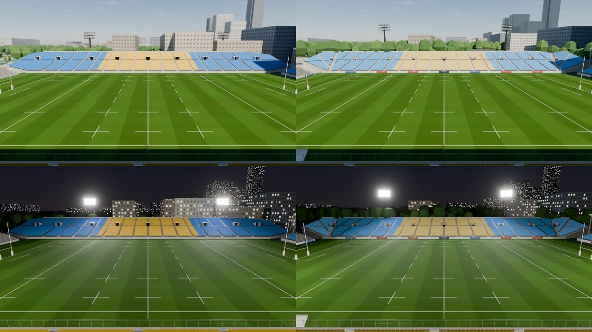
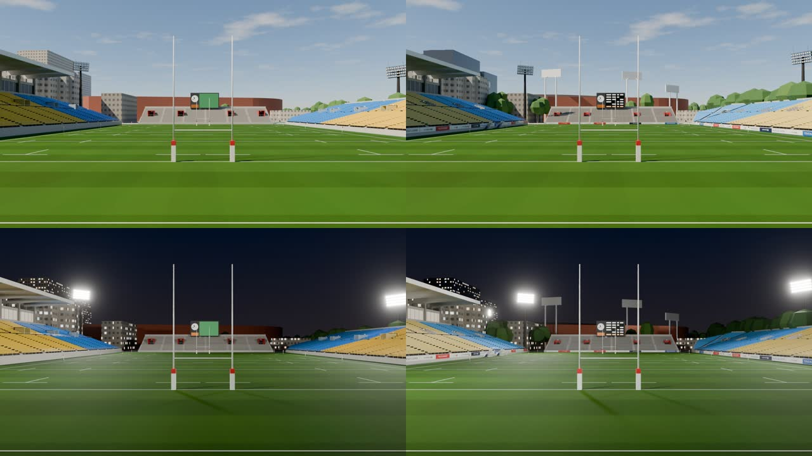
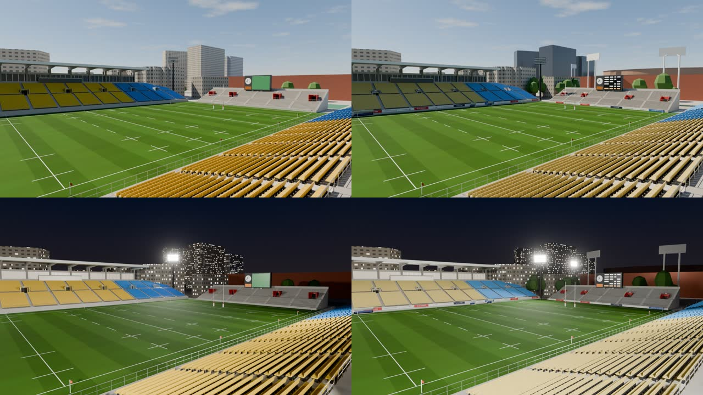
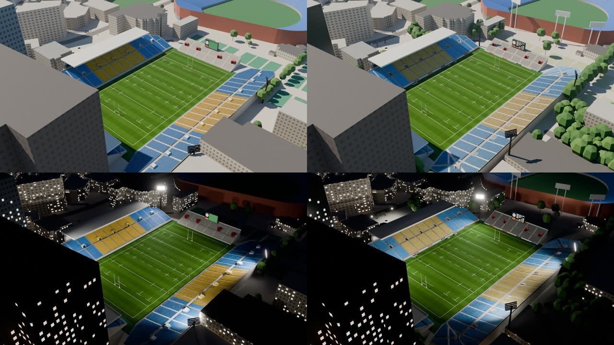
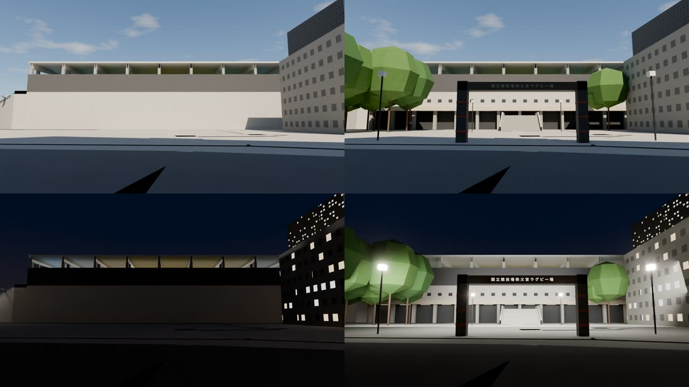
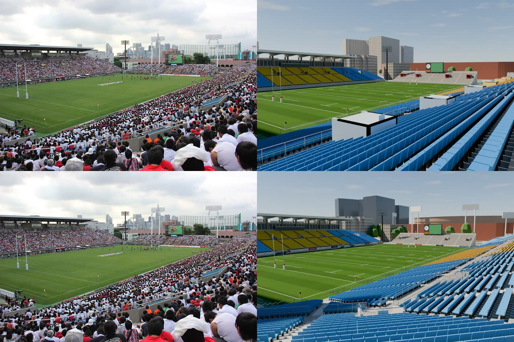
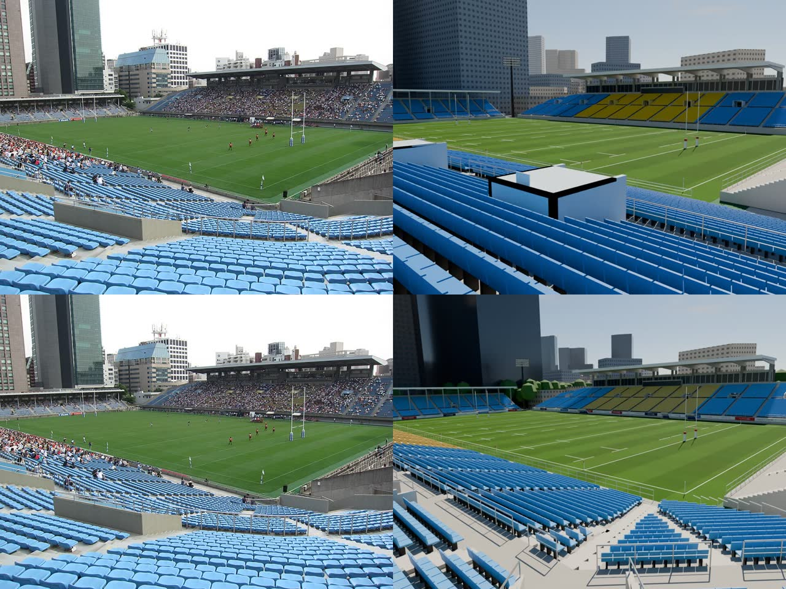
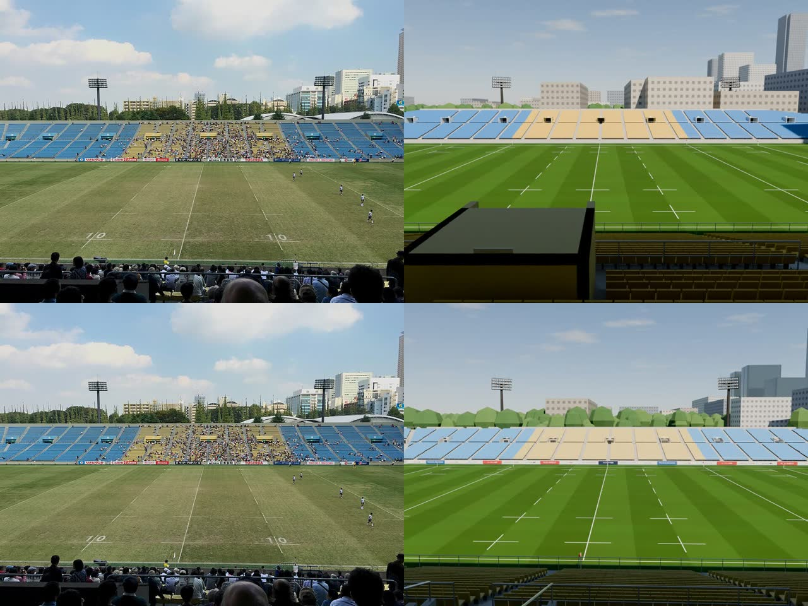
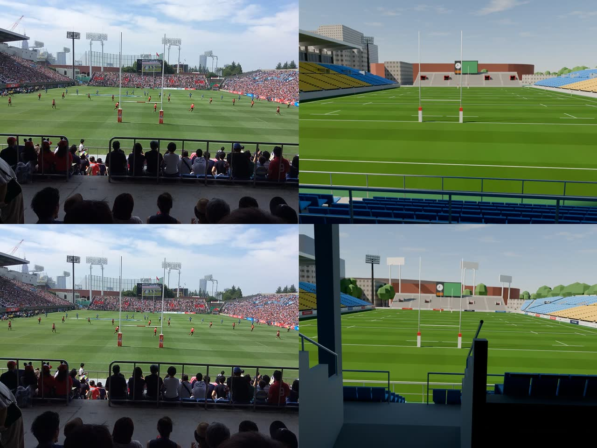
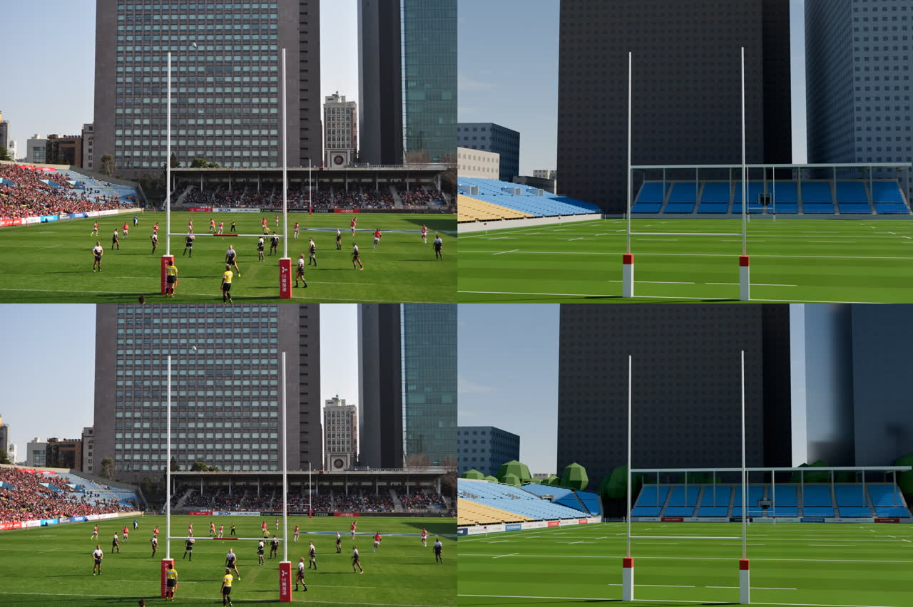

# 夜のループの報告(2026-11-17 23:40 〜 2026-11-18)

秩父宮ラグビー場の模型を、写真との違いが大きい順に 1 つずつ直した記録。
各項目は写真と同じ角度で描き直して確かめ、良くなったものだけコミットした(描画は CPU、`nice -n 10`)。

- 直した項目は 31(23:43 〜 01:38)。ほかに、調べて直さなかったもの 3 件と、試して戻したもの 1 件がある。1 件ごとの時刻と結果は [PROGRESS.md](../PROGRESS.md) の「夜のループ」の表にある。
- **01:38 のあとセッションが止まり、06:20 に再開した**。そのため 5:00 に予定していたまとめ(この報告と描き直し)は 06:20 から作った。止まっていたあいだに新しい直しはしていない。
- 花園の描画とフォルダには触れていない(06:20 の時点で花園の描画は終わっていた)。

## 直した所

### スタンドの形
- **バックスタンドの両端**を、芝の中央の方へ回り込む角のブロックにした(ゲート 9・17)。公式の座席図、空中写真の斜めの出入口、写真 Rugby1・Rugby2 から。
  向きは 45 度(写真 02 の手前の列と座席図)。段の高さは折れ目でつながる(`layout.py` の `corners`)。
- **出入口**を、白い箱から上の開いた穴(低い壁と手すり、奥に暗い口と色の枠)にした。北スタンドは壁まで赤く塗った(写真 06)。札にゲート番号 1〜21(公式の並び)。
- **南の屋根の柱**を写真 05 で数えた並び(7.8 m おき 10 本、中央に柱なし)にした。
- **北スタンドの段**に灰色の金属の長いベンチを足した(写真 06)。
- メインの前の壁ぎわに、写真 02 で位置を測った**白い屋根(ベンチ)3 つ**。

### 比較写真のカメラ(見比べの土台)
- 比較 01〜05 のカメラを、規定で決まった物(ポスト、クロスバー、芝のライン、フラッグ)の点から、位置・向き・傾き・焦点距離の最小二乗で解き直した(平均 1〜2 画素、`tools/fit_cam_*.py`)。
  前は見た目で合わせていて、01・02 は 2 度、03 は 3 度、04 は横に 4.8 m ずれていた。
- これで 2 つの思い違いがわかった:
  - 「映像装置が東へ 10 m ずれる」はカメラのずれで、**映像装置の位置は正しかった**。
  - 「東の照明塔 25 m」は、ずれたカメラに合わせた値だった(正しくは約 31 m)。
- 比較を 1 枚足した(06: メインの前段から北スタンドと得点板、2018 年)。

### 照明塔
- 4 基とも、解いたカメラの写真から測り直した。北西は写真 2 枚の向きの交点。**4 基とも上端約 31 m** で揃った。南西は写真 1 枚なので、北西と同じ角の位置とした推定。
- **神宮球場の照明塔 4 基**を、写真 2 枚の向きの交点から建てた。全部の組み合わせのうち、2 枚の写真から出した高さが合う組だけを使った。

### 外観
- **メインの裏(西)の外壁**を作った: 1 階の暗い吹き抜けと角柱、ベージュの帯、小窓、中央の大階段。階段の位置は OSM の steps と空中写真から。
- **正面入場口の門**(角柱 2 本と、施設名「国立競技場秩父宮ラグビー場」の梁)。位置は OSM の入口の通路から。
- **夜の外観**: 吹き抜けの天井灯、街灯 4 本、門の文字の明かり、外壁を照らす光。

### 周りの街
- **国立競技場**(OSM の名前は MUFGスタジアム)。OSM の relation(外周と内周の輪)を読むようにし、大きな形を作った。
- **木**: 空中写真の濃い緑から 124 本を足した。林と並木は 13〜21 m と高くした(写真 03 のスタンドの後ろの木の帯)。
- 高さ 60 m 以上の塔をガラスの外壁にした。屋内テニス場など sport のタグのある建物は低く推定した。
- テニスコートの色を、空中写真のコートの中で測った淡い灰緑にした。

### 色と細部
- 青い座席を写真の日向の明るい空色に、黄色い座席をくすんだからし色にした。
- 四方の前の壁に、架空の社名の看板を並べた。
- 得点板を、緑の画面から写真どおりの黒い LED の板(白い文字、左に時計)にした。
- 仕上げの角度を 2 つ直した。ゴール裏は柱が正面をふさいでいた。外観は門の柱と木がふさいでいたので、門越しの構図にした。

### 調べて直さなかったもの、試して戻したもの
- 比較 01 の奥の大きなビル 3 棟は、2017〜2020 年に建った実在の建物だった(写真の時期の差)。
- 写真 03 の看板の高さは、模型と同じだった。
- 神宮第二球場の高いネット(写真 01・04)は今はない(OSM ではテニスコート)。
- 南スタンドの段の高さ(蹴上げ 0.36 m)を試したが、写真 04 の手前の手すりが合わず戻した。

## 直す前と後

### 仕上げの 5 角度(左が夜の前 4876e35、右が今。上が昼、下が夜)
カメラは両方とも今の位置で描いた。確認用の大きさ(1280×720、32 サンプル)。

| 角度 | 画像 |
|---|---|
| 中継風(メインの後段から) |  |
| ゴール裏(南の前段から) |  |
| バックスタンドの客席から |  |
| 空から(南東) |  |
| 外観(正面入場口) |  |

### 写真との比較(上が夜の前、下が今。左が写真、右が模型)
夜の前の比較は、カメラがずれていた。写真の出どころとライセンスは [compare/README.md](compare/README.md)。

| 比較 | 画像 |
|---|---|
| 01 バックスタンド南から北西 |  |
| 02 北東の隅からメインと南 |  |
| 03 メインからバックスタンド |  |
| 04 南スタンドから北 |  |
| 05 北のポストの後ろから南 |  |

06(北スタンドと得点板)は夜に足した比較なので、前はない: [compare/06_north_stand.jpg](compare/06_north_stand.jpg)

## 残っている違い(大きい順の抜き出し。全部は [remaining.md](remaining.md))

1. **南スタンドの断面**: 比較 04 を解いたカメラは模型の段より低い。蹴上げか、柱の前後の位置が違うらしいが決め手がない。
2. **外側**: メインの裏と正面入場口のほかはまだ。北・南・東の外側の階段や東入場口、門の両脇の柵、売店がない。スタンドの端の外側(写真 047 の太い縁の梁と外の階段)もない。
3. **周りの建物の高さの 9 割は推定**(床面積から)。周りは今(2026 年)の姿で、写真(2012〜2018 年)にない建物もある。
4. **北東の角のブロック**: 列の向きは合ったが、出入口の壁の位置と、角の段の高さは推定(比較 02 のカメラは段より 4 m 高い)。
5. 比較 06 のカメラは遠くの上下が不確か。メインの屋根の柱の本数(写真では影で数えられない)。段数(東以外は推定)。席数は 21,620+北の立見で約 23,800 人(公式 24,871 人)。

## スキルへの意見の要点(夜に足した分。全文は [skill-feedback.md](skill-feedback.md) の 16〜22)

- **回り込むスタンドが書けない**(16): 断面を押し出す仕組みは、まっすぐなスタンドだけを前提にしている。折れ目で切って回した断面を足す方法を、例として載せてほしい。公式の座席図はブロックの向きまで描いてあるので、段階 1 で四隅を見る手順も入れてほしい。
- **カメラは規定の寸法だけで解き、未知の物はあとで測る**(19): 同じ写真で、カメラと照明塔の高さの両方を合わせていたため、3 度のずれが隠れていた。芝のラインやポストの点から最小二乗で解く道具と、写真に模型の線を投影する道具をスキルに入れるとよい。
- **カメラを解いた写真 2 枚の向きの交点で、背景の物の位置が測れる**(21)。どれとどれが同じ物かわからないときは、全部の組み合わせを試し、高さの合う組を残す。
- **OSM の relation を読み飛ばすと、大きな建物が抜ける**(20)。国立競技場がこれだった。
- **出入口の形はひな形の箱と違うことが多い**(18)。箱だと、比較写真の手前に黒い箱が写る。
- 空中写真はコントラストを上げると細部が読める(17)。色は OSM の外形の中で測る(22)。前者で斜めの出入口が読め、後者は一度コートの外で測って誤った。

## 流し方

```
./run.sh build
DEVICE=CPU blender -b build/chichibu.blend -P scripts/render.py -- --views all5 --time both --res 1280x720 --samples 32 --out out/overnight/after --jpg
DEVICE=CPU blender -b build/chichibu.blend -P scripts/compare.py -- --samples 24 --width 1280 --blend
python3 -I tools/lines_overlay.py <写真> <出力.png> cx cy cz tx ty tz lens W H   # 写真に模型の線を重ねる
```
